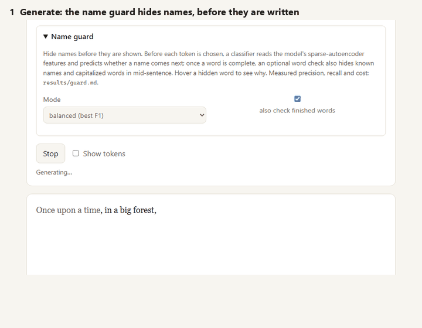

# Glassbox

[](https://github.com/muhimranhidayathamzh/glassbox/actions/workflows/ci.yml)
[](https://muhimranhidayathamzh.github.io/glassbox/)
[](LICENSE)

**A small language model built from scratch, taken apart with 2026-era interpretability tools, and
turned into a measurable product feature.** Everything runs on a laptop CPU, and the demo runs entirely
in your browser: no server, no API key.

**[Open the live demo](https://muhimranhidayathamzh.github.io/glassbox/)**: [Generate](https://muhimranhidayathamzh.github.io/glassbox/) ·
[Microscope](https://muhimranhidayathamzh.github.io/glassbox/microscope.html) ·
[Replay](https://muhimranhidayathamzh.github.io/glassbox/replay.html)

**[Read the case study](https://muhimranhidayathamzh.github.io/glassbox/case-study.html)**: what was built, what worked, what did not, and how the
numbers were kept honest.



## What is inside

| layer | what was built | where |
|---|---|---|
| 1. Built from scratch | byte-level BPE tokenizer, GPT-style transformer, training loop, and a JavaScript inference engine with KV cache, all without ML libraries beyond `torch.nn` primitives | `python/glassbox/`, `web/engine/` |
| 2. Microscope | sparse autoencoder on the residual stream, automatic feature labels, steering, ablation-validated attribution, training replay with induction-head scores | `sae.py`, `features.py`, `steer.py`, `attribution.py`, `induction.py` |
| 3. Mind-reading guard | hides character names by reading SAE features *before* the token is chosen, benchmarked against a regex and classifiers | `guard.py`, `web/engine/guard.js` |

The browser pages:

- **Generate**: one-click examples (a plain story, a story steered toward "cat", names hidden), or write
  your own; *Steering* pushes it toward a concept with an SAE feature; *Name guard* hides names and shows
  why each word was hidden.
- **Microscope**: type text, click a token to see the active features and a circuit graph of the
  features that led the model to write it (computed by ablation in the browser). Switch between
  sparse autoencoders with k = 8, 16 or 32 active features per token.
- **Replay**: slide through the checkpoints saved during training: loss curves, per-head induction and
  previous-token scores, attention patterns, and what the model wrote at that point.

## Results

Every number below and in `results/` is written by a script and can be regenerated.

<!-- results:start -->
<!-- Generated by `python -m glassbox.eval.summary` from results/*.json. Do not edit by hand. -->

| layer | result | report |
|---|---|---|
| Model from scratch | 2.6M-parameter transformer trained on CPU in 3.0 h (28.7M tokens). Validation loss **1.902** vs 3.528 for a bigram model and 5.869 for unigram. | [lm_eval](results/lm_eval.md) |
| Browser engine | JavaScript forward pass matches PyTorch to 2.2e-05 in the logits; 2,000/2,000 stories tokenize identically; ~214 tokens/s in Node.js. | [web_parity](results/web_parity.md) |
| Sparse autoencoder | k = 8, 2,048 features: variance explained 0.888, loss +12.7% when spliced in (PCA with the same k: +3.87 nats). 87% of features have most of their strongest examples on one token, vs at most 42% for residual dimensions, random directions or an untrained SAE. | [sae_eval](results/sae_eval.md), [sae_features](results/sae_features.md) |
| Steering | Feature directions at strength 0.5 make 83% of stories mention the concept, vs 9% for random directions of the same size (9% without steering), at a cost in fluency. | [steering](results/steering.md) |
| Attribution | Against ablation, gradient x activation ranks features best (Spearman 0.73); direct logit attribution 0.17, because 58% of the effect flows through attention from earlier positions. | [attribution](results/attribution.md) |
| Training replay | 23 checkpoints. **No induction head formed**: best prefix-matching score 0.031 (threshold 0.5), while a control model reaches 0.90. | [induction](results/induction.md) |
| Name guard | On names never seen in fitting: regex + name list F1 0.69 (recall 52%); SAE-feature guard alone F1 0.46; **regex or SAE guard catches 71% of names** (94% in strict mode), at 21 false blocks per 1,000 tokens; +0.65 ms per token. A follow-up, choosing on a separate selection split, moved the page's guard to the k = 32 SAE (test F1 on new names 0.47 vs 0.45). | [guard](results/guard.md), [guard_layers](results/guard_layers.md) |

### Negative and mixed results, reported as they came out

- **No induction heads** in this 2.6M-parameter model after 28.7M tokens, on random, frequent and natural repeated text alike. The probe works (positive control), so this is a property of the model and its training budget.
- **The SAE guard does not beat a regex** on its own (F1 0.46 vs 0.69): predicting a name before it is written is inherently uncertain. Its value is complementary: it catches names at the start of sentences that a regex cannot see.
- **The SAE used by the UI raises the model's loss by 12.7%** when spliced in, and 14% of its features are dead. It was chosen by a rule fixed in advance that turned out to be lenient. Across the shipped SAEs (k = 8, 16, 32), token specificity barely changes (86.9% to 87.0%) while the features that never fire on 2.1M validation tokens fall from 231 to 1; the microscope lets you switch between them.
- **Direct logit attribution**, the method named in the project brief, correlates weakly with the true effect of removing a feature (Spearman 0.17).
<!-- results:end -->

## Principles

1. No invented results: every number comes from a script that can be rerun.
2. Illustrations are labelled as such; samples are real model output.
3. Every claim is measured against a baseline (random directions, regex, simple classifiers, PCA).
4. Negative results are reported.
5. Fixed seeds everywhere; reruns reproduce the same files.

## Run the demo locally

```bash
python -m http.server 8000 -d web
# open http://localhost:8000
```

## Reproduce everything

Python 3.10+ and Node.js 20+, CPU only.

```bash
python -m venv .venv
.venv/Scripts/python -m pip install torch numpy pytest     # Linux/macOS: .venv/bin/python
.venv/Scripts/python -m pip install --no-deps -e .

# 1. data, tokenizer, model (about 3 hours on a 2-core laptop CPU)
python -m glassbox.data download && python -m glassbox.data prepare
python -m glassbox.train --out-dir runs/main --max-steps 7000 --threads 4 --log-interval 50
python -m glassbox.eval.lm_eval --run-dir runs/main

# 2. browser engine
python -m glassbox.export && python -m glassbox.eval.web_parity

# 3. sparse autoencoders and microscope (about 1 hour)
python -m glassbox.sae pilot
for k in 8 16 32; do python -m glassbox.sae train --k $k --out runs/sae_k$k; done
python -m glassbox.eval.sae_eval --runs runs/sae_k8 runs/sae_k16 runs/sae_k32
python -m glassbox.export sae && python -m glassbox.features

# 4-6. steering, attribution, training replay, name guard
python -m glassbox.steer && python -m glassbox.attribution
python -m glassbox.induction
python -m glassbox.guard

# follow-ups: larger SAEs in the microscope, and which internal signal the name guard should read
for k in 16 32; do python -m glassbox.export sae --sae runs/sae_k$k/sae.pt --out web/model/sae_k$k &&   python -m glassbox.features --sae-dir web/model/sae_k$k --results-name sae_features_k$k; done
python -m glassbox.eval.sae_index
python -m glassbox.guard_layers    # may move the page's guard (web/model/guard.json) to another SAE

# README results table, case study page and post drafts (docs/linkedin_post_*.md), all from results/
python -m glassbox.eval.summary && python -m glassbox.eval.writeup

# demo GIF, microscope screenshot and link preview (need Chrome and Pillow, and the site served on port 8765)
node docs/demo/frames.mjs http://127.0.0.1:8765/ docs/demo/frames && python docs/demo/make_gif.py docs/demo/frames docs/demo.gif
node docs/demo/og.mjs http://127.0.0.1:8765/
```

## Tests and CI

```bash
pytest                                   # Python tests, JS unit tests, JS-vs-PyTorch parity
cd web && node --test "test/*.test.mjs"  # JS unit tests only
ruff check python tests
```

The parity tests run the JavaScript engine (through Node.js) and PyTorch on the same exported weights:
logits within 1e-3, identical tokenization and greedy generation (including past the context window),
matching SAE activations, steered generation, ablation effects and guard scores. They run on a small
random model every time and on the shipped model in `web/model`. GitHub Actions runs lint, all tests,
checks that this README, the case study and the post drafts match `results/`, and deploys `web/` to GitHub
Pages.

## Layout

```
python/glassbox/
  tokenizer.py   data.py   model.py   train.py   sample.py   export.py
  sae.py         features.py   steer.py   attribution.py   induction.py   guard.py   guard_layers.py
  eval/          lm_eval, web_parity, sae_eval, sae_index, summary, writeup
web/
  index.html  microscope.html  replay.html  case-study.html (generated)  og.png  img/
  engine/        tokenizer, model (KV cache, hooks), SAE, sampling, generation, attribution, guard
  ui/            page logic and styles
  model/         exported weights, tokenizer, SAEs (sae, sae_k16, sae_k32), feature data, replay data, guard
  test/          JS unit tests;  tools/  Node bridge for the parity tests
tests/           pytest suite
results/         script-generated reports
docs/            demo GIF and the scripts that record it, link preview script, post drafts (generated)
```

## Data and licenses

- Code: [MIT](LICENSE).
- Training data: [TinyStories](https://huggingface.co/datasets/roneneldan/TinyStories) (Eldan & Li, 2023),
  under CDLA-Sharing-1.0. The dataset itself is not included. Short excerpts of its validation stories
  appear in the feature examples; see [DATA_NOTICE.md](DATA_NOTICE.md).
